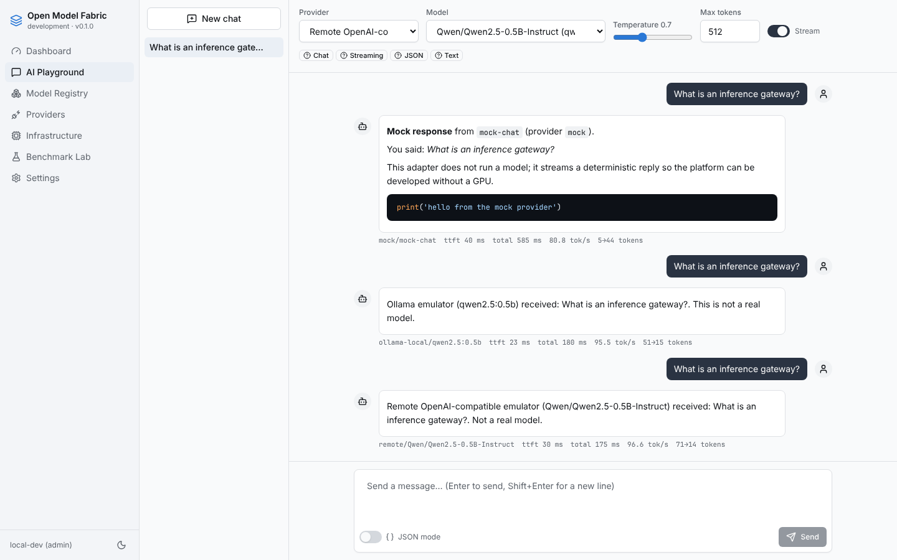
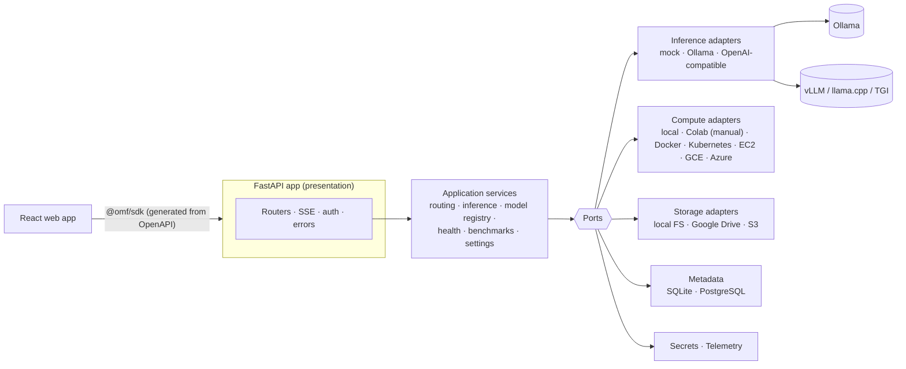

# Open Model Fabric

**A provider-neutral, open-source AI application platform.** One gateway, one web UI and
one SDK in front of interchangeable inference engines, compute environments, artifact
stores and metadata databases, so you can swap any of them without touching application
or domain code.



*The same chat UI talking to a mock provider, an Ollama server and a remote
OpenAI-compatible server in one conversation. This screenshot comes from the automated
end-to-end test, where the Ollama and OpenAI-compatible servers are protocol emulators;
point the same configuration at real servers for real models.*

## What you get

| Area | What is implemented |
|---|---|
| **Inference gateway** | REST + Server-Sent Events streaming with a normalised event contract (`message.started`, `message.delta`, `usage.reported`, `message.completed`, `request.failed`), cancellation (explicit and on client disconnect), correlation ids, structured errors |
| **Adapters** | Inference: mock (no GPU), Ollama (native API), OpenAI-compatible (vLLM, llama.cpp, TGI, LM Studio, …). Compute: local machine, Google Colab notebook (manually managed, ephemeral), and managed lifecycle (opt-in, admin-only) for Docker, Kubernetes, AWS EC2, Google Compute Engine and Azure VMs. Storage: local filesystem, Google Drive, S3-compatible. Metadata: SQLite and PostgreSQL (Alembic migrations). Secrets: environment and files. Telemetry: structured logs and optional OpenTelemetry |
| **Provider registry** | Explicit adapter catalog with schema-validated configuration. Providers can be added, tested, enabled and disabled at runtime without a restart |
| **Capability registry** | Claims with evidence (`verified` > `provider_reported` > `declared`). Anything undeclared is unsupported, and the UI only offers controls a model declares (e.g. image upload for vision models) |
| **Routing** | Explicit provider, default provider, preferred provider with fallback, capability-based selection. Fallback must be enabled explicitly, happens only on retryable errors before any output, and sensitive prompts never go to external providers |
| **Model registry** | Model definitions (family, modalities, context window, quantization, runtimes, artifacts, license) kept separate from deployments on specific providers |
| **Benchmarks** | Versioned prompt datasets, cold vs warm measurements, TTFT, latency, tokens/s, error rates, hardware/quantization fingerprints, comparability warnings, CSV/JSON export (also to Google Drive) |
| **Web app** | React + TypeScript + Vite + Tailwind + shadcn/ui-style components: Dashboard, AI Playground, Model Registry, Providers, Infrastructure, Benchmark Lab, Settings |
| **Colab lab** | `notebooks/colab_model_lab.ipynb`: hardware and memory detection, optional Drive mount, pinned-revision safetensors download, checksums, TTFT and tokens/s measurement, CSV/JSON export, clean teardown; runs standalone |
| **Security** | Backend-only secrets referenced as `env:`/`file:`, API-key auth with user/admin roles, SSRF egress policy, request limits, upload validation, CORS allowlist, audit log, no prompt text in telemetry by default |
| **Developer experience** | `make dev` (no GPU), Docker/Compose/Kubernetes, generated OpenAPI contract and TypeScript SDK, strict typing (mypy, tsc), lint, unit/contract/integration/e2e tests, CI, security scanning |

## Quick start (no GPU, no cloud account)

```bash
make install    # uv + pnpm, from lockfiles
make dev        # API http://127.0.0.1:8080 (docs at /docs) + UI http://localhost:5173
```

Then try `make demo` (the same request against mock → Ollama → OpenAI-compatible) and
`make e2e` (the same thing in a real browser). See the
[quickstart](docs/getting-started/quickstart.md) to connect real Ollama or vLLM
servers.

## Architecture in one picture



The core (`python/omf/core`) never imports a web framework, HTTP client, database driver
or provider SDK; a test enforces that boundary. Adapters are registered explicitly in one
composition root (`python/omf/bootstrap/catalog.py`), and configuration can only select
them by id. Details: [architecture overview](docs/architecture/overview.md),
[ADRs](docs/architecture/adr/README.md).

## Repository layout

```text
apps/api/omf_api          FastAPI application (routers, SSE, auth, middleware)
apps/web                  React web app + Playwright e2e tests
python/omf/core           domain model, ports, application services (no infrastructure)
python/omf/adapters       inference / compute / storage / metadata / secrets / telemetry
python/omf/bootstrap      configuration profiles, adapter catalog, composition root
packages/contracts        generated OpenAPI contract
packages/sdk-typescript   @omf/sdk — typed client with SSE streaming
notebooks                 Google Colab model lab
configs                   development, local-ollama, colab-experiment, docker, production.example
infrastructure            Dockerfile, Compose, Kubernetes manifests
tests                     unit · contract · integration (+ protocol emulators)
examples/react-chat       minimal chat UI built on the SDK
docs                      architecture, ADRs, providers, deployment, security
```

## Status and honesty notes

* **Verified in this repository's test suite:** startup without a GPU, mock end to end,
  streaming, cancellation (explicit and on disconnect), provider switching (UI and API),
  meaningful errors for unavailable providers, capability-driven UI, the storage contract
  for all three storage adapters, persistence across restarts, configuration validation,
  credentials never appearing in API responses, benchmark export, standalone notebook
  execution (smoke mode), and graceful behaviour when Colab is offline. The suite runs
  against SQLite and PostgreSQL (16 locally, 17 in CI), on Python 3.11 and 3.13, and is green in GitHub Actions (including the browser e2e test, the Docker build and the notebook smoke run).
* **Tested against protocol emulators, not real engines:** Ollama and OpenAI-compatible
  servers (`tests/emulators`) and Google Drive (`tests/contract/fake_drive.py`). S3 is
  tested with `moto`. Real Ollama, vLLM, Google Drive and AWS were not reachable from the
  development environment. Running `make demo`/`make e2e` with `E2E_OLLAMA_URL`/
  `E2E_OPENAI_URL` set exercises real servers.
* **The notebook's real Hugging Face download/GPU path** is written for Colab but was
  only executed in offline smoke mode (tiny random Qwen2 model on CPU).
* **Not implemented yet:** tool-calling request/response passthrough, embeddings
  endpoints and audio (these are declared in the capability vocabulary only);
  SSO/OIDC; rate limiting.
* **Compute lifecycle adapters:** only Docker was tested against the real service.
  Kubernetes, Compute Engine and Azure were tested against REST fakes, and EC2 against
  moto.

See [docs/implementation-status.md](docs/implementation-status.md) for the phase-by-phase
report.

## Model licenses

Open-weight model licenses are **not** open-source software licenses; some restrict
commercial use. The catalog records license metadata per model — read
[model licensing](docs/providers/model-licensing.md). Model weights are never committed
to this repository.

## Contributing and security

[CONTRIBUTING.md](CONTRIBUTING.md) · [CODE_OF_CONDUCT.md](CODE_OF_CONDUCT.md) ·
[SECURITY.md](SECURITY.md) · [Writing an adapter](docs/providers/developing-adapters.md)

## License

Apache License 2.0 — see [LICENSE](LICENSE). Copyright the Open Model Fabric
contributors.
