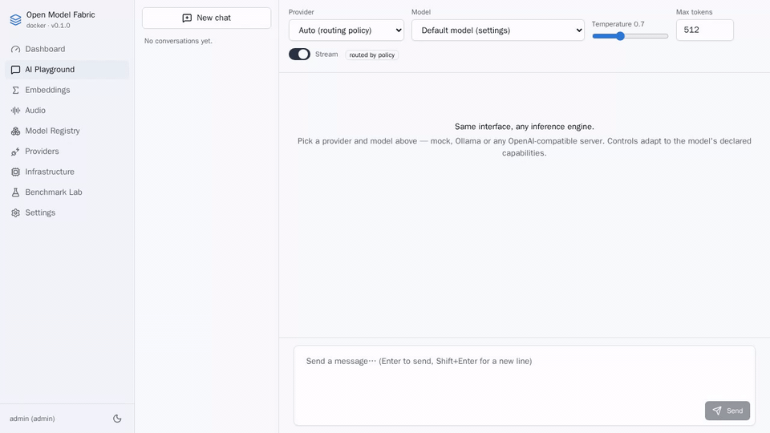
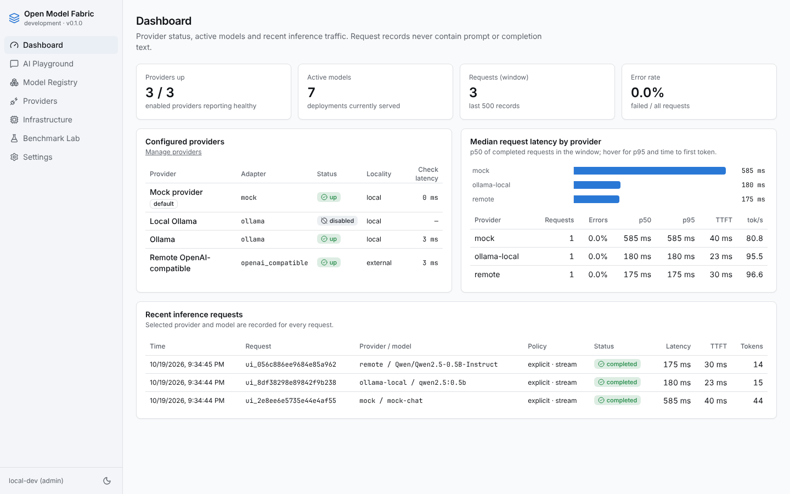
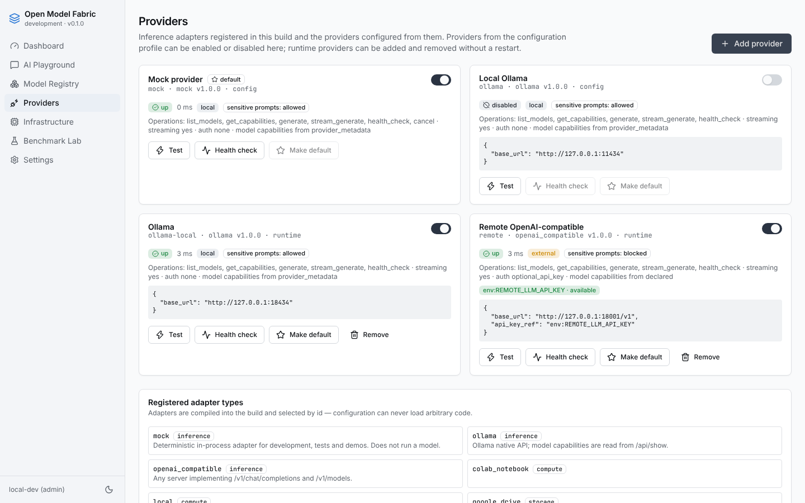
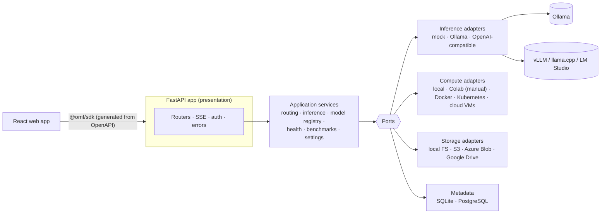

<div align="center">



### One gateway, one UI, one SDK for every open model you run.

Swap Ollama, vLLM, llama.cpp, LM Studio or any OpenAI-compatible server without touching
your app. Compare them side by side, with evidence. **No GPU required to start.**

[](https://github.com/findajay/Open-model-fabric/actions/workflows/ci.yml)
[](LICENSE)


[Quick start](#-quick-start) · [Connect a model](#-connect-a-real-model) ·
[Features](#-what-you-get) · [Architecture](#-architecture) · [Docs](docs/README.md)

</div>

<br>

<p align="center">
  
  <br>
  <sub>Real recording: Qwen2.5-0.5B in Ollama on a laptop CPU, streamed through the Playground. First token in 38 ms.</sub>
</p>

## ✨ Why Open Model Fabric

- **Stop rewriting integrations.** Your app speaks one API (REST + streaming, typed
  TypeScript SDK). Engines are adapters you switch in config or at runtime.
- **Know what a model can really do.** Capabilities carry evidence: `verified` by a
  probe, `provider_reported`, or just `declared`. The UI only offers what the model
  supports.
- **Measure, don't guess.** The Benchmark Lab runs versioned prompt sets and reports
  time-to-first-token, latency and tokens/s per engine and hardware.
- **Safe by default.** Secrets stay on the server, prompts marked sensitive never leave
  local providers, fallbacks are opt-in, and every routing decision is recorded.

## 🚀 Quick start

### Option A: Docker (Windows, macOS, Linux)

You need [Docker](https://docs.docker.com/get-docker/) (Docker Desktop on Windows/macOS).

```bash
git clone https://github.com/findajay/Open-model-fabric.git
cd Open-model-fabric
cp .env.example .env            # Windows PowerShell: Copy-Item .env.example .env
```

Set `OMF_ADMIN_TOKEN` in `.env` to a random string of 16+ characters
(`openssl rand -hex 24`, or `[guid]::NewGuid().ToString("N")` in PowerShell) and
`OMF_ENABLE_OLLAMA=true`. Then:

```bash
docker compose --env-file .env -f infrastructure/compose/docker-compose.yml --profile ollama up --build -d
docker compose --env-file .env -f infrastructure/compose/docker-compose.yml exec ollama ollama pull qwen2.5:0.5b
```

Open **http://localhost:8080**, go to **Settings** and paste your token. Pick provider
`ollama` in the Playground and start chatting. Port 8080 taken? See
[troubleshooting](docs/getting-started/troubleshooting.md).

### Option B: from source (Linux, macOS, or WSL2 on Windows)

Prerequisites: [uv](https://docs.astral.sh/uv/), Node.js 20+, `make`, and pnpm via
`corepack enable`.

```bash
make install    # Python + Node dependencies from lockfiles
make dev        # API on http://127.0.0.1:8080 + UI on http://localhost:5173
```

No token, no GPU, no cloud account: the `mock` provider answers instantly. Then try
`make demo` (one request against mock → Ollama → OpenAI-compatible) and `make check`
(lint, types and the test suite CI runs).

> On Windows, clone inside WSL2 (not under `/mnt/c`) for the source route. The
> [laptop test guide](docs/getting-started/laptop-test-guide.md) walks through every
> feature step by step.

## 🔌 Connect a real model

Anything that speaks the Ollama or OpenAI API works. Add it under **Providers → Add
provider**, no restart needed, or in a config profile:

| Engine | Adapter | Typical `base_url` |
|---|---|---|
| [Ollama](https://ollama.com) | `ollama` | `http://127.0.0.1:11434` |
| [vLLM](https://docs.vllm.ai) | `openai_compatible` | `http://gpu-box:8000/v1` |
| [llama.cpp server](https://github.com/ggml-org/llama.cpp) | `openai_compatible` | `http://127.0.0.1:8080/v1` |
| [LM Studio](https://lmstudio.ai) | `openai_compatible` | `http://127.0.0.1:1234/v1` |
| Hosted APIs (OpenRouter, Groq, …) | `openai_compatible` | provider's `/v1` URL, key via `api_key_ref` |

API keys are never stored in config: profiles reference them as `env:NAME` or
`file:/run/secrets/name`. Details: [quickstart](docs/getting-started/quickstart.md) ·
[model compatibility](docs/providers/model-compatibility.md).

### Do you even need a GPU?

For small models, often not. Same prompts, same model, measured with this project:

<p align="center">
  
</p>

A 4-bit build on a laptop CPU beat the unquantized model on a free cloud T4. GPUs win
for larger models; the [Benchmark Lab](#-what-you-get) and the
[Colab notebook](notebooks/colab_model_lab.ipynb) let you find the crossover for your
own hardware.

## 🧰 What you get

<table>
<tr>
<td width="50%" valign="top">

**🎛️ Gateway and routing**<br>
REST + Server-Sent Events with one event contract, cancellation, tool calling,
embeddings, speech-to-text and text-to-speech. Explicit, default, preferred-with-fallback
and capability-based routing.

</td>
<td width="50%" valign="top">

**🧪 Playground and Benchmark Lab**<br>
Chat with any provider, toggle streaming, JSON mode and tools. Versioned prompt sets,
cold vs warm runs, TTFT, tokens/s, hardware fingerprints, CSV/JSON export.

</td>
</tr>
<tr>
<td valign="top">

**📚 Model registry**<br>
What a model *is* (family, context, license, quantization) kept apart from where it
*runs*. Capability claims with evidence; one-click verification.

</td>
<td valign="top">

**🔐 Security built in**<br>
API keys with expiry and rotation, OIDC single sign-on, roles, rate limits, SSRF egress
policy, audit log, no prompt text in telemetry by default.

</td>
</tr>
<tr>
<td valign="top">

**☁️ Compute and storage adapters**<br>
Local, Docker, Kubernetes, AWS, Google Cloud and Azure compute; local disk, S3, Azure
Blob and Google Drive storage; SQLite or PostgreSQL metadata.

</td>
<td valign="top">

**🛠️ Developer experience**<br>
`make dev` without a GPU, generated OpenAPI contract and TypeScript SDK, strict typing,
unit, contract, integration and browser e2e tests in CI.

</td>
</tr>
</table>

<details>
<summary><b>🖼️ More screenshots</b></summary>
<br>

| Dashboard | Providers |
|---|---|
|  |  |

**Playground with three engines in one conversation** (from the automated e2e test,
where Ollama and the OpenAI-compatible server are protocol emulators):


</details>

## 🏗️ Architecture



The core (`python/omf/core`) never imports a web framework, HTTP client, database driver
or provider SDK, and a test enforces that boundary. Adapters are registered explicitly in
one composition root (`python/omf/bootstrap/catalog.py`). More:
[architecture overview](docs/architecture/overview.md) · [ADRs](docs/architecture/adr/README.md) ·
[writing an adapter](docs/providers/developing-adapters.md).

<details>
<summary><b>📁 Repository layout</b></summary>

```text
apps/api/omf_api          FastAPI application (routers, SSE, auth, middleware)
apps/web                  React web app + Playwright e2e tests
python/omf/core           domain model, ports, application services (no infrastructure)
python/omf/adapters       inference / compute / storage / metadata / secrets / telemetry
python/omf/bootstrap      configuration profiles, adapter catalog, composition root
packages/contracts        generated OpenAPI contract
packages/sdk-typescript   @omf/sdk — typed client with SSE streaming
notebooks                 Google Colab model lab
configs                   development, local-ollama, colab-experiment, docker, production.example
infrastructure            Dockerfile, Compose, Kubernetes manifests
tests                     unit · contract · integration (+ protocol emulators)
examples/react-chat       minimal chat UI built on the SDK
docs                      architecture, ADRs, providers, deployment, security
```

</details>

<details>
<summary><b>✅ What is tested, and how</b></summary>
<br>

* **In CI:** startup without a GPU, mock end to end, streaming, cancellation, provider
  switching, errors for unavailable providers, capability-driven UI, storage contracts,
  persistence across restarts, configuration validation, credentials never appearing in
  API responses, benchmark export and the notebook smoke run. Python 3.11 and 3.13,
  SQLite and PostgreSQL, plus a browser e2e test and the Docker build.
* **Against protocol emulators in CI, and real engines by hand:** Ollama and
  OpenAI-compatible servers (`tests/emulators`); real Ollama with Qwen2.5 was used for the
  recording above. Google Drive is tested against a fake, S3 with `moto`.
* **Compute lifecycle:** Docker against the real service; Kubernetes, Compute Engine,
  Cloud Run and Azure against REST fakes; EC2 and ECS against `moto`.
* **Not implemented yet:** server-side tool execution (tool calls are passed through to
  the client) and an OIDC login UI (OMF validates SSO tokens; clients obtain them).

Full report: [implementation status](docs/implementation-status.md).

</details>

## ⚖️ Model licenses

Open-weight model licenses are **not** open-source software licenses, and some restrict
commercial use. The catalog records license metadata per model; read
[model licensing](docs/providers/model-licensing.md). Model weights are never committed
to this repository.

## 🤝 Contributing

Issues and pull requests are welcome. Start with [CONTRIBUTING.md](CONTRIBUTING.md),
[the code of conduct](CODE_OF_CONDUCT.md) and [writing an adapter](docs/providers/developing-adapters.md).
Security reports: [SECURITY.md](SECURITY.md).

## 📄 License

Apache License 2.0, see [LICENSE](LICENSE). Copyright the Open Model Fabric
contributors.
