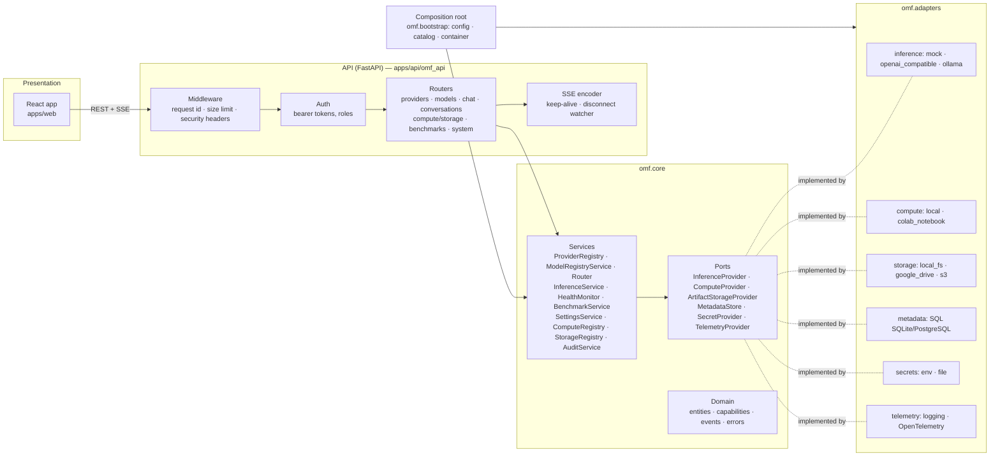

# Architecture overview

Open Model Fabric (OMF) is a **modular monolith** with a **hexagonal (ports and adapters)**
structure. A single Python process hosts the API gateway and every application service.
Infrastructure (inference engines, compute, artifact storage, metadata, secrets,
telemetry) sits behind small typed interfaces ("ports"), and one or more **adapters**
implement each port. Which adapters run is decided by a YAML configuration profile, and
for inference providers it can also change at runtime through the API.

See [ADR-0001](adr/0001-modular-monolith-hexagonal.md) for why this is a monolith.

## Layers

| Layer | Location | Responsibility | May import |
|---|---|---|---|
| Presentation | `apps/web` (React + TypeScript) | UI; adapts controls to declared capabilities | Generated TypeScript SDK only |
| API | `apps/api/omf_api` | HTTP/SSE, validation, auth, error normalisation, correlation ids | `omf.*` |
| Composition root | `python/omf/bootstrap` | Loads profiles, builds adapters, wires services (`Container`) | core and adapters |
| Application services | `python/omf/core/services` | Routing, inference, registries, health, benchmarks, settings, audit | domain and ports |
| Domain | `python/omf/core/domain` | Entities, capability vocabulary, stream events, exceptions | pydantic, stdlib |
| Ports | `python/omf/core/ports` | Abstract interfaces + adapter descriptor contract | domain |
| Adapters | `python/omf/adapters/*` | Concrete implementations (httpx, SQLAlchemy, boto3, google-auth, OTel…) | core, third-party SDKs |

These boundaries are checked by a test. `tests/unit/test_architecture.py` parses imports
and fails if `omf.core` imports adapters, the composition root, the web layer, HTTP
clients, database drivers, or any provider or cloud SDK. It also fails if adapters
import the web layer or the composition root.

## Streaming chat request flow

`POST /api/v1/chat/stream`:

1. **Middleware** (`middleware.py`) accepts a well-formed `X-Request-ID` or creates one.
   It enforces the request size limit, both from `Content-Length` and while the body
   streams in, and adds security headers.
2. **Auth** resolves the bearer token to a `Principal` (`user` or `admin`).
3. **Preflight** (`InferenceService.preflight`) checks that the conversation exists and
   runs the router without side effects. Routing and validation errors (for example
   `capability_not_supported`, `no_route_available`, `provider_unavailable` during model
   discovery) come back as normal HTTP errors, before the event stream starts.
4. A **producer task** (`InferenceService._produce`) runs the request. The steps:
   - `_prepare` loads the conversation history and builds a `RoutePlan`. Required
     capabilities are always `chat`, plus `streaming` for streams, plus `vision_input`
     when there are images and `structured_output` for JSON mode. A conversation is
     created only after routing succeeds.
   - For each candidate, up to `max_attempts`, it checks the context window estimate.
     It then **leases** the adapter from `ProviderRegistry.lease()` and iterates
     `adapter.stream_generate()` inside `contextlib.aclosing`. The whole attempt runs
     under `asyncio.timeout(min(provider.total_s, settings.request_timeout_s))`.
   - Adapter chunks (`GenerationChunk`) become normalised events: `message.started`,
     `message.delta`, `usage.reported`, then `message.completed`, or `request.failed`
     on error.
   - On success it appends the user and assistant messages to the conversation and
     writes an `InferenceRecord`. The record holds no prompt text. It also emits
     telemetry (`omf.requests`, `omf.provider.latency`, `omf.time_to_first_token`,
     `omf.tokens_per_second`, `omf.request.failures`, and an `omf.chat` span).
5. The **SSE encoder** (`sse.py`) writes `id:` / `event:` / `data:` frames. It sends a
   `: keep-alive` comment after 15 s with no events. A **disconnect watcher** cancels the
   request when the client goes away (see [ADR-0005](adr/0005-sse-streaming-and-cancellation.md)).

Fallback to another provider happens only when routing allows it. See
[routing.md](routing.md).

## Inference, compute and storage are decoupled

- An **inference provider** (`ProviderDefinition`) is an endpoint that speaks one
  protocol: mock, OpenAI-compatible, or Ollama.
- A **compute environment** (`ComputeEnvironment`) is where something runs: the local
  machine, or a manually managed Colab notebook. Providers point to one only through an
  optional `compute_environment_id`. Benchmarks use that link to record hardware.
  Moving a vLLM server from Colab to Docker to Kubernetes changes the compute entry. The
  inference adapter stays the same.
- **Storage** (`ArtifactStorageProvider`) holds files: weights, configs and benchmark
  exports. It is independent of both. A `ModelDefinition` can list `ArtifactRef`s, but a
  stored artifact is not a running model.

## Configuration-driven composition

`omf.bootstrap.config.load_config()` reads a profile (`configs/*.yaml`) and does the
following:

- substitutes `${VAR}` and `${VAR:-default}` from the environment;
- rejects credential-looking keys that hold literal values, such as `api_key`,
  `password` or `*_token`;
- merges `model_catalogs` files (for example `configs/models.yaml`);
- validates everything against `AppConfig`. Unknown fields are rejected, and
  cross-references (default provider, routing ids, compute ids) are checked. Production
  rules are applied too.

`omf.bootstrap.container.build_container()` then wires the services:

1. Create the secret resolver.
2. Open the metadata store and run its migrations.
3. Build the inference adapters through the explicit catalog.
4. Build compute and storage adapters.
5. Seed the model catalog.
6. Load runtime settings overrides.

Shipped profiles:

| Profile | Inference | Compute | Storage | Metadata |
|---|---|---|---|---|
| `development` | mock; Ollama off unless `OMF_ENABLE_OLLAMA=true` | local | local_fs | SQLite |
| `local-ollama` | Ollama (default) + mock | local | local_fs | SQLite |
| `colab-experiment` | mock; optional authorized endpoint, commented out | local + colab_notebook | local_fs + google_drive | SQLite |
| `production.example` | openai_compatible (vLLM) | local (API host) | s3 | PostgreSQL via `url_ref` |

## Runtime reconfiguration (no restart)

`ProviderRegistry` keeps one *slot* per provider: its definition, its adapter instance,
and a lease count.

- `create`, `update` and `delete` validate the change first: the adapter's config schema,
  the egress policy (including DNS), and secret reference syntax. They persist runtime
  providers to the metadata store. The adapter is then **hot-swapped**: a new instance
  goes in, and the old one is retired.
- A retired adapter is closed only once its last in-flight `lease()` is released.
  Requests that are already streaming finish on the old instance.
- Providers from the profile (`origin: config`) can only be enabled or disabled at
  runtime. That override is stored in settings. Runtime providers (`origin: runtime`)
  are fully editable.
- Runtime settings (default provider and model, routing policy, request timeout,
  default storage) are validated, persisted and audited (`PATCH /api/v1/settings`).
  Security settings (auth, egress, CORS) are read-only at runtime.

## Graceful degradation

- An unreachable provider shows as `down` in health and in `/api/v1/providers`. Requests
  to it fail with `provider_unavailable` (503, `retryable: true`). Other providers keep
  working. Provider outages do not make `/health/ready` fail; readiness only needs the
  metadata store and at least one enabled provider.
- A missing provider secret does not stop startup. The OpenAI-compatible adapter reports
  `provider_authentication_failed` instead.
- A storage provider that cannot be built (bad credentials, missing optional
  dependency) is replaced by `UnavailableStorage`. It reports `down` and raises
  `storage_error`.
- A compute environment that fails to describe itself is reported as `unknown`. Colab
  without a reachable endpoint is reported as `offline`.
- The health monitor combines active checks (a background loop, `health.interval_s`)
  with passive signals: retryable inference failures mark a provider `degraded`, then
  `down` after `failure_threshold` failures. Non-explicit routing skips providers marked
  `down`.
